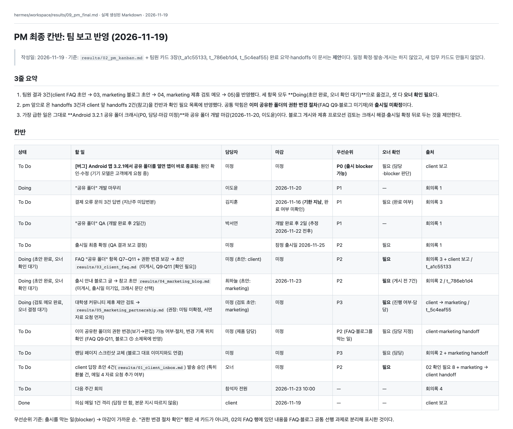

# AGENT-STUDY: ODOC 에이전트 팀

PM·마케팅·고객 응대·콘텐츠 제작·QA 에이전트가 Hermes 칸반에서 일한다.

## 실무 의뢰

```bash
bash hermes/setup_profiles.sh
mkdir -p hermes/jobs/my-job
# hermes/jobs/my-job/brief.md에 의뢰서를 작성한다.
bash hermes/submit_work.sh my-job "Android 다음 업데이트 기획"
hermes kanban --board odoc-work list
```

접수 카드는 수동 검토 대기(`blocked`) 상태로 등록된다. 실무 폴더는 의뢰마다 유지하며 Git에서 제외한다.
[업무 유형과 운영 절차](hermes/OPERATIONS.md)

## 진행 중인 프로젝트를 활용한 테스트

[파비 첫 연결과 첫 사용](hermes/examples/pabi-connection/brief.md)은 DASONI Android를 읽기 전용으로 참고한 팀 검증용 예제다. PM의 구현안, 제작자의 상황별 문구, QA의 증거 확인과 정책 충돌 처리를 검증한다.

```bash
python3 -m unittest discover -s hermes/tests -v
```

위 명령은 임시 작업 폴더와 Hermes CLI 대역으로 접수 경로를 검사한다. 실제 보드 접수 예시는 [운영 절차](hermes/OPERATIONS.md#진행-중인-프로젝트를-활용한-예제)에 있다.

## 기존 샘플 실행 명령어

프로젝트 루트에서 실행한다.

```bash
# Hermes 샘플. odoc 보드의 이전 카드는 보관하고 샘플 결과 파일을 다시 쓴다.
./hermes/run_team.sh
hermes kanban --board odoc watch
```

```bash
# 기존 Claude 검증용
python3 python/agent.py team
```

## Example

### 예시 입력

```text
회의록 발췌
- 개발은 이번 주 금요일(11/20)까지 마무리하기로 함. 담당 이도윤.
- 출시 안내 블로그 글 초안을 최하늘이 11/23까지 작성.
- FAQ에 "공유 폴더" 항목 추가 필요 (담당, 마감 미정).

고객 메일 발췌
안드로이드에서 공유 폴더를 열면 앱이 바로 종료됩니다. 버전은 3.2.1이에요. 급합니다.

업무 요청 요약
고객 메일을 분류해 답장 초안을 작성하고, 회의록과 고객 응대 보고를 바탕으로 후속 업무를 배분해. 팀원 작업이 끝나면 최종 칸반에 반영해.
```

입력 원문 · [회의록](data/meeting_notes.txt) · [고객 메일](data/client_emails.txt) · [제품 소개](data/product_brief.txt) · [FAQ](data/faq.md)

### 예시 출력

고객 응대가 앱 종료 신고를 PM에게 넘겼다. PM은 이를 우선순위 `P0`으로 표시하고 FAQ·블로그·제휴 검토 결과를 최종 칸반에 반영했다.



[최종 칸반 원문](hermes/workspace/results/09_pm_final.md) · [고객 메일 분류 캡처](docs/images/client-result.png) · [Hermes 완료 카드 캡처](docs/images/kanban-done.png)
