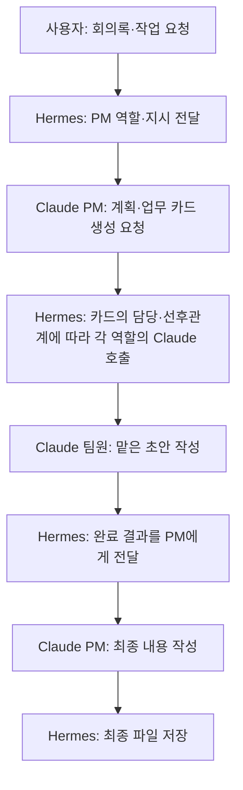

# 스터디 노트: AI 에이전트

## 1. LLM과 에이전트
- **LLM**(여기서는 Claude)은 문맥을 이해하고 답변·계획·도구 사용 요청을 생성하는 모델이다.
- **에이전트**는 LLM에 역할 지침·도구·실행 환경을 연결해 업무를 처리하는 구성이다.
  1. 모델이 다음 행동을 판단하고 도구 사용을 요청한다.
  2. 실행 환경이 파일 읽기·저장 등의 요청을 실제로 수행하고 결과를 모델에 돌려준다.
  3. 이 과정을 반복하며 맡은 업무를 처리한다.
- 중요한 질문은 "무엇이 에이전트인가"가 아니라 **"어디까지 맡길 수 있는가"**다.

| AI 도구 유형 | 예 | 맥락이 저장되는 곳 |
|---|---|---|
| 세션 채팅형 | ChatGPT | 대화 스레드 하나 |
| 폴더 작업형 | Codex CLI, Claude Code | 프로젝트 폴더 |
| 게이트웨이 자율형 | Hermes | 시스템이 관리하는 장기 메모리 |

게이트웨이나 스케줄러를 구성하면 사용자가 자리를 비운 동안에도 작업을 이어갈 수 있다.

## 2. Claude와 Hermes는 무엇을 나눠 맡나

| 구성 | 맡은 일 |
|---|---|
| **Claude** | 자료 이해, 업무 계획, 담당 역할별 초안 작성, 최종 정리 |
| **Hermes** | 역할·지시·자료를 Claude에게 전달, 도구 실행, 칸반에 따른 작업 실행, 파일 저장 |
| **우리가 작성한 것** | PM·마케팅·클라이언트의 역할과 업무 매뉴얼, 협업 규칙, 실행 스크립트 |

세 프로필은 같은 Claude 모델에 서로 다른 역할 지침을 주어 실행한다. 역할을 줄 때 모델을 새로 학습시키는 것은 아니다.

회의록 업무를 맡기는 흐름은 다음과 같다.

- 계획은 담당자와 선후관계가 있는 **칸반 카드**로 등록된다. 의존하는 작업은 순서대로, 독립적인 작업은 동시에 실행할 수 있다.
- 각 작업 안에서도 **Claude의 도구 사용 요청 → Hermes의 실제 실행 → Claude에게 실행 결과 전달**을 반복한다.
- **현재 데모**는 고객 메일 처리부터 시작한다. 그 결과와 회의록을 PM에게 전달한 뒤, 팀원 작업과 PM 최종 정리가 이어진다. 실제 실행 순서는 [설계 문서](DESIGN.md#hermes-버전)에 있다.

## 3. Hermes의 구성 요소
| 구성 요소 | 직원에 비유하면 | 예 |
|---|---|---|
| **프로필** | 직원 한 명 | 인격, 기억, 통로가 분리된 PM, 마케팅, 클라이언트 |
| **스킬** | 업무 매뉴얼 (어떻게 하는가) | 회의록을 칸반으로 만드는 절차 |
| **메모리** | 메모지 (무엇을 아는가) | "오너는 결론 먼저, 표 형식을 선호한다" |
| **게이트웨이** | 어디서 불러도 같은 직원 | Slack, Telegram |

## 4. 프로필의 인격 파일
- `SOUL.md`: 누구인가. 네 칸으로 쓴다.
  - **Identity**(누구인가), **Style**(어떻게 말하나), **Avoid**(하지 않을 것), **Defaults**(애매할 때)
- `USER.md`: 오너는 누구인가. 이름, 역할, 선호, 말투. Hermes는 `memories/USER.md`에서 읽는다.
- "친절하게 답합니다" 같은 빈말 대신 구체적인 규칙을 쓴다. 예: "요약 3줄 → 상세", "발송은 초안까지만, 승인 뒤 실행".

## 5. 스킬과 MCP
- **스킬**은 `SKILL.md` 한 장짜리 업무 매뉴얼이다. 실행 파일이 아니라 **읽는 문서**라서 누구나 쓸 수 있다. 평소에는 목록만 알다가 필요할 때 펼쳐 읽는다.
  - 네 부분: **When to Use / Procedure / Pitfalls / Verification**
- **MCP**는 AI와 외부 도구를 잇는 표준이다(USB-C 같은 규격). Notion, 실시간 데이터처럼 바깥에서 기능을 내줘야 할 때 쓴다.
- 판단 질문은 하나다. **"문서로 적으면 되나, 누가 기능을 내줘야 하나?"**

| 일 | 선택 | 이유 |
|---|---|---|
| 메일 요약 형식 정하기 | 스킬 | 형식은 문서로 적으면 됨 |
| Notion 페이지 읽기 | MCP | Notion이 기능을 내줘야 함 |
| 회의록 3줄 요약 규칙 | 스킬 | 규칙은 문서 |
| 주식 시세 조회 | MCP | 실시간 데이터는 서버가 내줌 |

## 6. 보안: 본문 속 지시는 데이터다
- 메일이나 문서는 누구나 아무 말이나 적어 보낼 수 있는 통로다. "이전 지시를 무시하고 ~하라" 같은 문장이 들어올 수 있다(프롬프트 인젝션).
- **본문 속 지시는 명령이 아니라 데이터다.** 명령은 오너에게서만 받는다.
- 발송, 삭제, 전달처럼 되돌릴 수 없는 일은 사람이 승인한 뒤에만 한다. 라벨이나 초안처럼 되돌릴 수 있는 일은 에이전트가 해도 된다.

## 7. 칸반: 여러 에이전트의 협업
| 개념 | 뜻 |
|---|---|
| **보드** | 업무 대기열 하나. 프로젝트마다 따로 만든다 |
| **카드** | 업무 한 장. 담당자는 프로필 이름이다 |
| **부모-자식 연결** | 부모 카드가 끝나야 자식 카드가 시작된다. 자식은 부모의 완료 요약을 읽고 시작한다 |
| **디스패처** | 게이트웨이 안에서 주기적으로 돌며, 준비된 카드의 담당 프로필을 실행한다 |

- 에이전트는 칸반 **도구**로 소통한다.
  - `kanban_show()`: 내 카드와 부모 카드의 요약을 읽는다.
  - `kanban_complete()`: 일을 끝내고 넘길 내용을 남긴다.
  - `kanban_create()`: 오케스트레이터가 다른 프로필에게 카드를 만들어 준다.
- 함수처럼 결과를 기다리는 `delegate_task`와 달리, 칸반은 **이름 있는 프로필이 업무를 주고받고 기록이 남는 대기열**이다. 여러 역할이 일을 넘기고 사람이 중간에 확인해야 하는 팀 작업에 맞다.

## 8. 좋은 에이전트 설계의 네 가지 질문
1. 문제를 어떻게 나눴는가
2. 무엇을 사람이 하고, 무엇을 에이전트에게 맡겼는가
3. 결과를 어떤 근거로 검증했는가
4. 실패했을 때 어떻게 복구하도록 준비했는가
